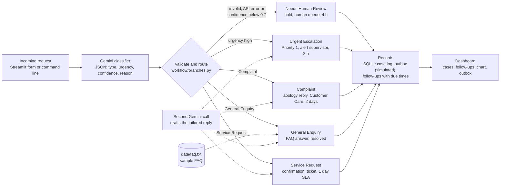

# Incoming Request Processing Workflow

A prototype that reads a customer request, classifies its type and urgency with Gemini, runs a branch-specific workflow, drafts a tailored reply, sets a follow-up and logs the case. Built for the Firstsource Consultant (AI & Analytics) POC.
Repo: https://github.com/ShibilaThangavelu/request_workflow | Demo: [add link]

## Architecture


## Folder guide
| Folder or file | What it is |
| --- | --- |
| `workflow/classifier.py` | Gemini calls: classify a request (JSON) and draft a tailored reply |
| `workflow/branches.py` | Routing rules, the five branch functions, SQLite case log, outbox and follow-ups |
| `ui/app.py` | Streamlit app (main UI): input, result, messages, dashboard tabs. `app_classic.py` is the earlier layout |
| `evaluation/` | `evaluate.py` (type and urgency accuracy), `evaluate_branches.py` (full routing on harder cases), `test_gemini.py` (API key check) |
| `data/` | `requests.csv` (24 labelled), `edge_cases.csv` (30 harder), `faq.txt` (sample FAQ), `results/` (evaluation outputs), `cases.db` (created on first run, not committed) |
| `requirements.txt`, `.env` | Dependencies; API key (`.env` is not committed) |

## Workflow design
Request (Streamlit form or command line) -> Gemini returns JSON `type`, `urgency`, `confidence`, `reason` -> `workflow/branches.py` validates it -> branch runs its steps, drafts a reply with a second Gemini call, sends the reply to the customer and a routing notification to the right team (simulated, saved in an outbox table), sets a follow-up -> case saved in SQLite (`data/cases.db`). The app also shows open follow-ups with due times, a cases-by-branch chart, the case log and the outbox.
Invalid output, an API error or confidence below 0.7 goes to **Needs Human Review**. Otherwise urgency `high` goes to **Urgent Escalation**, and anything else goes to the branch for its type.

## Classification logic
- **Complaint:** unhappy about something that went wrong. **General Enquiry:** asks for information. **Service Request:** asks us to do or change something.
- **Urgency:** high = fraud, stolen card, loss of service or access, or "immediately"; medium = recurring or unresolved; low = questions and routine changes. Vague messages get confidence below 0.6.

## Remediation strategy
| Branch | Steps | Follow-up |
| --- | --- | --- |
| Complaint | Tailored apology reply; route to Customer Care | Specialist contact in 2 business days |
| General Enquiry | Answer from sample FAQ (`data/faq.txt`); log as resolved | None |
| Service Request | Confirmation reply; create ticket, route to Service Desk | SLA timer, 1 business day |
| Urgent Escalation | Urgent acknowledgement; Priority 1 flag, alert supervisor, pause auto-resolution | 2 hours |
| Needs Human Review | Hold automatic actions; queue for a human with the reason | Review in 4 hours |

Sending is simulated: replies and notifications are written to an outbox table, not emailed. Real sending would use SMTP or an email API. The FAQ is made-up sample content.

## Tools
Python, Gemini (`gemini-3.5-flash-lite`) via `google-genai`, Streamlit, SQLite, pandas. Built with AI assistance (Claude).

## Setup
```
python3 -m venv .venv && source .venv/bin/activate
pip install -r requirements.txt
echo "GEMINI_API_KEY=your-key" > .env
streamlit run ui/app.py                          # web app
python -m workflow.branches "your request"       # command line
python evaluation/evaluate.py dev                # or: test (labelled requests)
python evaluation/evaluate_branches.py           # 30 harder cases
```

## One example per branch (real output)
| Input | Result | Draft reply (start) |
| --- | --- | --- |
| "I was charged twice for my March bill and nobody has fixed it after three calls." | Complaint | "We are very sorry to hear that you were charged twice..." |
| "Do you offer a student discount on your plans?" | General Enquiry | "Students get 10% off any plan with a valid student ID." |
| "Please update my address to 12 Smith Street, Richmond VIC 3121." | Service Request | "We have received your request to update your address..." |
| "My card was stolen an hour ago. Please block it immediately." | Urgent Escalation | "Your case has been escalated to our priority team..." |
| "Hi, about my thing from last week" | Needs Human Review | No automatic reply |

## Results and limits
24 synthetic labelled requests (AI-assisted, no real data): dev 15/16 type and urgency (measured before the confidence rules were added); held-out test, run once, 7/8 type and 6/8 urgency. The small sample makes these rough indications. Confidence is self-reported and often high when wrong, and the 0.7 threshold is untuned. Next: real email and ticketing, more data, human approval of drafts.

Stress test: 30 harder requests (`data/edge_cases.csv`: varied wording, urgent cases, vague, gibberish and mixed-intent messages), labelled before running and run once: **28/30 sent to the right branch (93%)**; the 7 of 8 vague or mixed messages were correctly held for a person. Both misses went to a wrong automatic branch, not to human review: a casual complaint about being charged twice went to Urgent Escalation, and "Thanks, that fixed it!" went to General Enquiry. Details in `data/results/results_edge.csv`.
